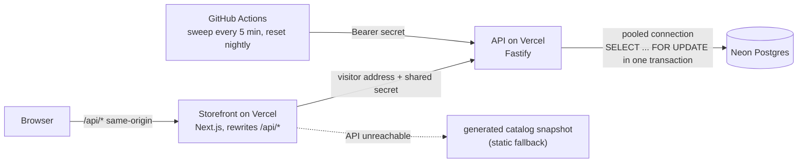
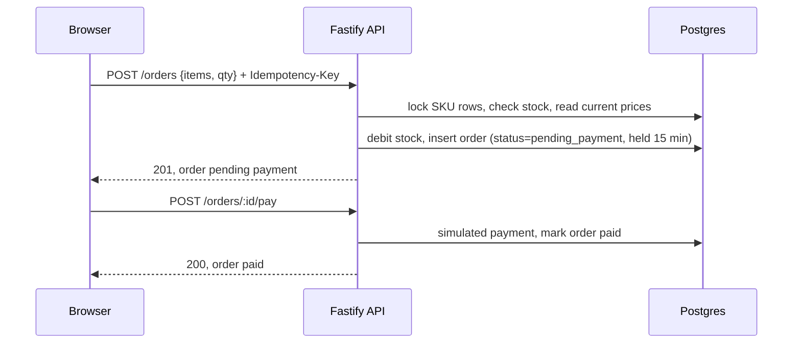
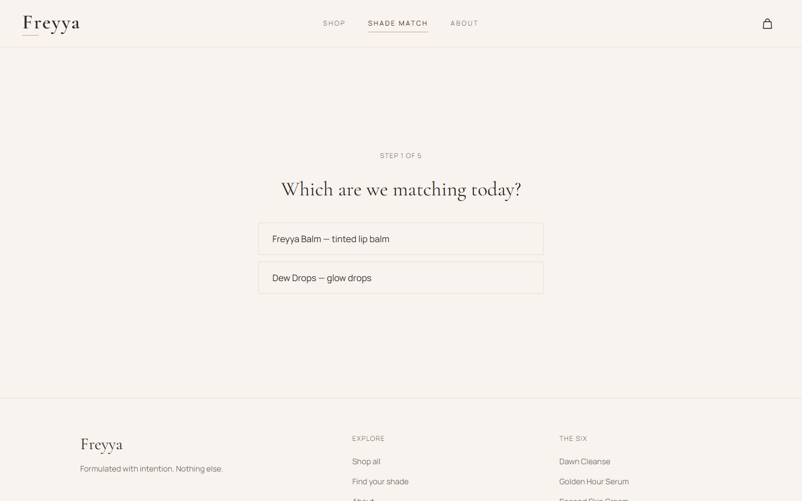
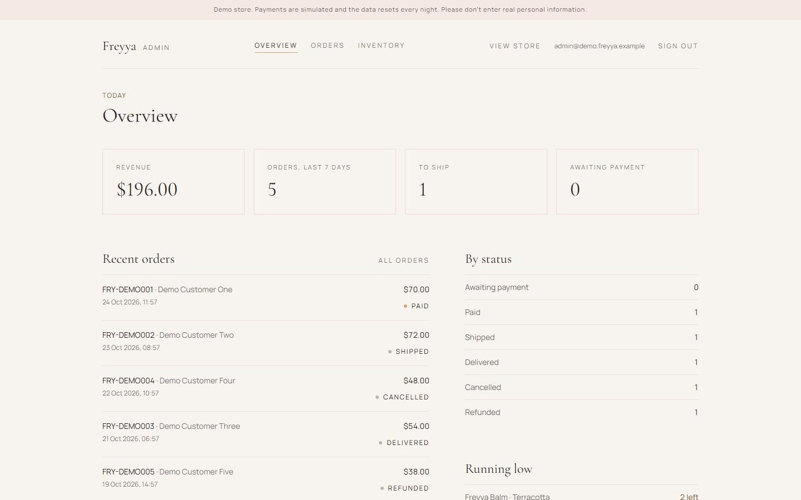
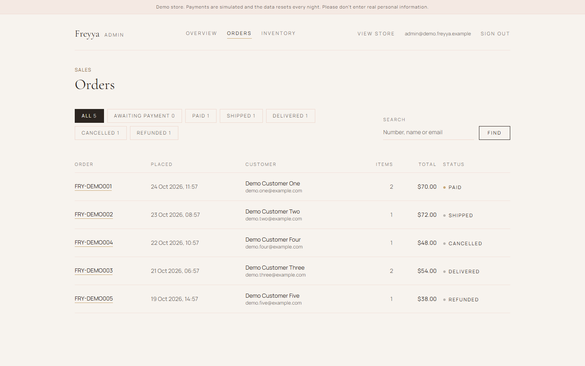
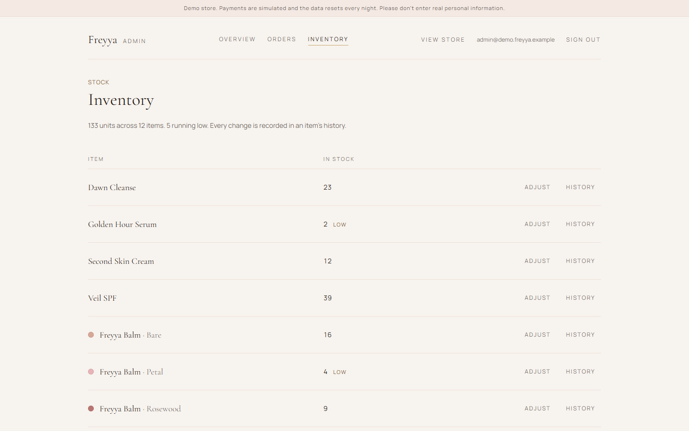

# Freyya

A full-stack e-commerce platform (Next.js frontend, Fastify/PostgreSQL backend) built around correctness under concurrent checkout: server-side pricing, row-level stock locking, time-boxed reservations, and idempotent order creation.

## Live Demo

**Storefront: [freyya.vercel.app](https://freyya.vercel.app/)** · **API: [freyya-api.vercel.app](https://freyya-api.vercel.app/health)** (`/health`)

The whole stack is deployed, not just the storefront: the Next.js storefront and the Fastify API run as two Vercel projects, on a Neon Postgres database that is used for nothing else. You can browse, check out with simulated payment, and sign in to the admin dashboard.

**Admin sign-in** at [freyya.vercel.app/admin](https://freyya.vercel.app/admin). These credentials belong to the demo only and are published on purpose:

| | |
| --- | --- |
| Email | `admin@demo.freyya.example` |
| Password | `ulKia9jzNW88rr4uyOGS` |

It is a public demo, so keep these in mind:

- **Everything resets every night** (03:00 UTC): orders, stock, sessions. Other visitors share the same data and may change it while you look.
- **Use made-up details at checkout.** Payment is simulated and nothing is shipped or emailed, but orders are real rows in a real database.
- **There are caps against abuse:** at most 6 orders an hour per address, and at most 8 unpaid orders at once, so the twelve items cannot all be held in one burst. Rate limits are shared across all server instances.
- **The first request after a quiet spell is slower** (free tier).

How it is put together, including the free-tier limits, is in [docs/DEPLOYMENT.md](docs/DEPLOYMENT.md). If the API is ever unreachable, the storefront falls back to a generated static snapshot of the catalog so pages stay browsable, and checkout says plainly that it cannot place orders.

## Overview

Freyya is a two-service e-commerce application: a Fastify/PostgreSQL API that owns the catalog, pricing, stock and orders, and a Next.js storefront and admin dashboard on top of it. The user flow is a standard one — browse a small catalog, add items to a cart, check out, and get a confirmed order — but the flow is treated as a correctness problem, not just a UI to build: the server, not the browser, decides what something costs and whether it can be sold, and it has to keep those answers right when multiple requests hit the same stock at once.

What I built and why it's the interesting part of the project: an order-placement path that takes a row-level lock on every SKU involved (in a fixed, sorted order, so two overlapping orders can't deadlock each other), checks stock inside that lock, and only then debits it and inserts the order — all in one transaction. Unpaid orders hold their stock for a fixed window and release it automatically if payment doesn't follow. Checkout requests carry a client-generated idempotency key, backed by a database unique constraint and a request fingerprint, so a retried or duplicated request can't create a second order or silently attach to the wrong one. None of this is asserted in prose only — it's exercised by concurrency tests that fire overlapping requests at a real Postgres database and check the outcome (see [Concurrency Testing](#concurrency-testing)).

The frontend is a full Next.js App Router build on top of that API: it never trusts a price or a stock count it's shown, re-validates its own local cart against the live catalog, and turns every API failure mode (timeout, rate limit, stock conflict, the API being unreachable) into a specific, recoverable message instead of a generic error.

## Key Features

**Catalog & product pages** — Six products (twelve SKUs counting shade variants), each with live per-SKU stock, ingredients/usage detail, and a shade-matching quiz that scores five answers against variant metadata (undertone, intensity).

**Cart** — Persisted in the browser and reconciled against the live catalog on every read: prices, images and stock are always re-derived from the current catalog rather than trusted from storage, and quantities are clamped to what's actually available (and to a fixed per-order limit, enforced identically on the client and the server).

**Checkout & pricing** — The client sends only item IDs and quantities. The server looks up current prices and computes the total; nothing about cost is accepted from the request. A structured error response (validation, stock conflict, rate limit, etc.) is mapped to a specific on-screen message and, where relevant, to which cart line caused it.

**Inventory reservations** — Placing an order holds stock against it for a configurable window (`RESERVATION_MINUTES`, default 15) with status `pending_payment`. If payment doesn't happen in time, the hold is released and the stock returned automatically.

**Order lifecycle** — Orders move through `pending_payment → paid → shipped → delivered`, with `cancelled`/`refunded` as terminal states reachable at specific points. Every transition is validated against an explicit table server-side; there is no route a client can use to set a status directly.

**Admin dashboard** (`/admin`, session-authenticated) — Order list with status filters and search, an order detail view with the full status timeline, manual status transitions, and inventory management (stock adjustments with a reason and an audited history per SKU).

**Authentication** — A single admin account (email/hashed password from environment configuration), sessions as random tokens in an HTTP-only cookie, origin checking on state-changing admin requests, and rate-limited login attempts.

**Payment** — Simulated behind a `PaymentProvider` interface. No real payment processor is integrated and no card data is collected or stored anywhere in the system.

## Engineering Highlights

This is the part of the project the rest of the README exists to support.

### Inventory correctness under concurrency

**The problem.** If two requests can each read "3 in stock," decide independently that they're allowed to buy 2, and then both write their debit, the item oversells — the read-then-write is not atomic. This gets worse, not better, under load: it's exactly the situation multiple people racing for the last few units of something create.

**The solution.** `Backend/src/services/orders.ts` places an order inside a single Postgres transaction:

1. The SKU rows for every item in the order are locked with `SELECT ... FOR UPDATE`, in a sorted, deterministic order (by SKU id) rather than the order the items happen to appear in the request. This is what stops two orders that share items from deadlocking each other — they always attempt to acquire locks in the same order, so one simply waits for the other instead of both waiting on each other.
2. With the rows locked, requested quantity is checked against the now-guaranteed-current stock. Anything short is rejected with `409 insufficient_stock` and the transaction does no writes.
3. Only if every line has enough stock does the transaction debit it and insert the order.

A `stock >= 0` check constraint at the database level is the last line of defense if application logic is ever wrong. Every stock change (order, cancellation, admin adjustment) is written through one function into an append-only `inventory_movements` ledger, so the running stock count can always be reconciled against its own history — the test suite asserts after every concurrency scenario that `stock == sum(ledger deltas)`.

**The proof.** See [Concurrency Testing](#concurrency-testing) below — this is verified, not just implemented.

### Checkout idempotency

**The problem.** A checkout request can succeed on the server and still look like a failure to the client — the response gets lost, the connection drops, a mobile network retries the POST. Retrying "place order" naively can create a second order and take stock a second time for something the buyer already bought once.

**The solution.** The client generates an idempotency key per checkout attempt (`crypto.randomUUID()`, changed only when the cart contents actually change) and sends it as a request header. `orders.idempotencyKey` has a database-level `UNIQUE` constraint. On the server:

- Before doing anything else, it looks up whether that key already has an order. If so, the existing order is returned (`200`, not `201`) instead of placing a new one.
- If two identical requests race each other and both reach the insert at the same time, the database constraint itself rejects the second `INSERT`; the code catches that unique-violation, re-queries, and returns the order the other request just created.
- The order is also fingerprinted (a hash of the buyer, address, shipping method, and item lines) at the time the key was first used. If the *same key* is later sent with a *different* cart, that's a client bug, not a legitimate retry — it's rejected with `422 idempotency_key_reused` rather than silently handing back an unrelated order for a different cart.
- If the client loses its connection *after* the server has committed the order, the retry (same key) simply returns that order — already paid, already cancelled, whatever its current state is — without repeating any side effect.

**The proof.** Ten identical concurrent requests with the same key produce exactly one order and debit stock once; this is asserted directly in `Backend/tests/concurrency.test.ts`.

### Server-side pricing

The client never sends a price, and the server never reads one from the request even if it's present — `Backend/src/schemas.ts` accepts only `{ skuId, quantity }` per line. Every total is computed at checkout time from the current row in `products`/`skus`. This closes the class of bug where a modified request body, a stale cached price, or a race between a price change and a checkout could let someone pay less than the current price.

### Database consistency

Beyond the locking behavior above, PostgreSQL check constraints enforce invariants independent of application code: stock can't go negative, order line totals must sum to the order total, and prices must be positive. Orders are inserted with their line items in the same transaction as the stock debit, so a crash mid-checkout can't leave an order with no items or stock taken with no order to show for it.

## Concurrency Testing

The core question these tests answer: **when multiple requests compete for the same limited stock at the same time, does the database's row-level locking actually prevent overselling, or does it only look correct in the common case?**

The representative test (`Backend/tests/orders.test.ts`, "never sells more than exists when many people order at once"): a SKU with 3 units in stock, and 10 concurrent requests each trying to buy 1. The assertion is exact — exactly 3 requests get `201 Created`, exactly 7 get `409 insufficient_stock`, stock ends at 0, and the inventory ledger sums to zero net change. This is the race condition that overselling comes from: without correct locking, some subset of those 10 requests would each read "stock available" before any of the others had committed a debit, and more than 3 orders would succeed.

Further concurrency tests in `Backend/tests/concurrency.test.ts` cover cases past the basic race:

- Ten identical requests sharing one idempotency key produce one order, not ten (see [Checkout idempotency](#checkout-idempotency)).
- A reused idempotency key attached to a *different* cart is rejected rather than silently merged.
- Concurrent buyer requests and admin stock adjustments on the same SKU, checked against the movement ledger afterward.
- An unpaid order's reservation expiring at the same moment a payment or another reservation-sweep is in flight — stock is released exactly once, not zero or twice.
- Concurrent order-status transitions (e.g., shipping and cancelling the same order at once) — exactly one wins, and stock ends consistent with whichever one did.

All of these run against a real PostgreSQL database (a disposable Neon branch), not mocks — the property being tested (row locks under contention) doesn't exist in an in-memory fake.

The main scenario has also been run against the deployed API on Vercel, through pooled Neon connections: 10 concurrent orders for an item with 3 in stock gave exactly 3 `201` and 7 `409`, the stock ledger still summed to the stock afterwards, and a repeated idempotency key returned the original order with `200` while the same key with a different cart was refused with `422`.

## Architecture



- The browser never calls the API directly. It calls `/api/*` on the storefront's own origin, and `next.config.ts` rewrites those requests server-side to the API's address. This keeps the admin session cookie same-origin without exposing the API's address to the browser.
- The API is the single source of truth for price, stock and order state. The frontend keeps a generated, versioned copy of the catalog and pricing rules (produced by a script from the API's own source data, checked in CI for staleness) purely as a static fallback for when the API isn't reachable — never as an alternative source of truth. Its own README documents the ownership rules in more detail.
- The cart and last-order confirmation are the only application state kept client-side (`localStorage`), and both are treated as untrusted input, re-validated against the API on every use.
- **The API is written to run serverless.** Nothing depends on a background process: expired stock holds are released when an order is placed, when the catalog is read, and by a scheduled call. Every time comparison uses the database clock, rate limits are counted in Postgres so all instances share them, and sessions are database rows. The storefront passes the visitor's address to the API, because the host would otherwise show the API only the storefront's own. [docs/DEPLOYMENT.md](docs/DEPLOYMENT.md) lists each concern and how it is handled.

**Checkout, end to end:**



## Technology Stack

| Layer | Technology |
| --- | --- |
| Frontend | Next.js 16 (App Router), React 19, TypeScript, Tailwind CSS 4, GSAP |
| Backend | Fastify 5, TypeScript, Zod (request/environment validation) |
| Database | PostgreSQL on Neon (pooled connection at runtime), Drizzle ORM, SQL migrations |
| Testing | Vitest, Testing Library, Playwright, axe-core |
| CI and jobs | GitHub Actions: lint, type-check, unit/integration tests, build, end-to-end tests; plus the stock-hold sweep, the nightly demo reset and a smoke test of the live site |
| Deployment | Vercel (two projects: storefront and API) and Neon. See [Live Demo](#live-demo) and [docs/DEPLOYMENT.md](docs/DEPLOYMENT.md) |

## Screenshots

| Shop | Product |
| --- | --- |
|  |  |



**Admin dashboard** (the deployed demo, with its synthetic data)

| Overview | Orders |
| --- | --- |
|  |  |



## Testing

Three layers, all run in CI on every push and pull request: **263 storefront tests** (Vitest/Testing Library), **304 API tests** (Vitest, against a real Postgres database), and **111 end-to-end tests** (Playwright, desktop and mobile viewports, against a production build and the real API). A fourth, read-only Playwright project (`Frontend/e2e-live`) checks the deployed demo and runs after every production deployment.

The API test suite is organized around correctness, not just coverage:

| File | What it verifies |
| --- | --- |
| `orders`, `pricing`, `catalog` | Order placement, pricing/shipping calculation, stock effects, one path at a time |
| `concurrency` | Every race condition described above — overselling, idempotency-key races, reservation-expiry races, admin/buyer contention — checked against a real database, with the stock ledger reconciled after each |
| `order-state-machine` | All 36 possible from→to status pairs, exercised through the real API, confirming exactly the allowed transitions succeed and every other one is rejected |
| `serverless` | What running on a serverless host needs: stock holds that expire with no background process, time taken from the database, rate limits shared by every instance, the address a request is counted against, the origin check, the demo caps and the nightly reset (including the cases where it must refuse). Also a guard that stops the test runner from ever connecting to the demo database |
| `security` | Every route is either explicitly public or requires a valid admin session (a test enumerates the route table so a newly added route can't be accidentally left open); cookie flags, origin checks, login rate-limiting, and rejection of malformed/hostile input |
| `auth`, `admin` | Session lifecycle, password hashing, inventory adjustments, order transitions via the admin API |
| `contract` | The frontend's generated catalog/pricing snapshot is byte-for-byte what the generator produces from the API's own source data — fails if the two have drifted |

On the frontend, the same discipline extends to the client: the cart's reconciliation logic (stock/price re-derivation, tampered or stale saved carts, a fixed per-order quantity limit) and the checkout form's handling of every API failure mode (timeout, network error, rate limit, stock conflict, the API being unreachable) are unit- and component-tested directly, and exercised again end-to-end in `Frontend/e2e/journeys.spec.ts` (including a scenario where a second buyer takes the last units of an item while the first is mid-checkout).

```bash
npm test          # storefront and API tests
npm run test:e2e  # end-to-end tests (needs Backend/.env.test)
LIVE_URL=https://freyya.vercel.app npm run test:live --prefix Frontend   # read-only checks of a deployed site
```

## Getting Started

**Prerequisites:** Node.js 22.9+ (required by the API; the storefront alone needs only Node 20.9+) and a PostgreSQL database — [Neon](https://neon.tech) has a free tier.

```bash
git clone https://github.com/alieldeenahmed/Freyya.git
cd Freyya
```

**Storefront only** (no database, uses the generated catalog snapshot; checkout and admin are disabled):

```bash
cd Frontend
npm install
npm run dev
```

**Full stack:**

```bash
npm run install:all
```

Copy `Backend/.env.example` to `Backend/.env` and set `DATABASE_URL`. Generate an admin password hash and set it, with `ADMIN_EMAIL`, in the same file:

```bash
npm run admin:hash -- "a password of at least 12 characters"
```

Then, in two terminals:

```bash
npm run db:migrate
npm run db:seed
npm run dev:api   # http://localhost:4000
npm run dev:web   # http://localhost:3000
```

The admin dashboard is at `http://localhost:3000/admin`.

| Command | What it does |
| --- | --- |
| `npm run install:all` | Install both packages |
| `npm run db:migrate`, `npm run db:seed` | Create tables, load the launch catalog |
| `npm run admin:hash` | Generate a password hash for admin login |
| `npm run typecheck`, `npm run lint` | Type-check both packages / lint the frontend |
| `npm test`, `npm run test:e2e` | Run the test suites described above |
| `npm run build` | Production build of both packages |

Environment variables for both packages are documented in `Backend/.env.example` and `Frontend/.env.example`. Notably: `RESERVATION_MINUTES` (stock hold duration, default 15), `LOW_STOCK_THRESHOLD`, and `CORS_ORIGINS`/`API_URL` for wiring the two services together.

## Project Structure

```text
Freyya/
├── Frontend/            Next.js storefront and admin UI
│   ├── app/             Routes (storefront + /admin)
│   ├── components/      UI components
│   ├── lib/             Cart logic, checkout, API client
│   ├── data/            Generated catalog/pricing snapshot (do not hand-edit)
│   ├── tests/           Vitest unit and component tests
│   └── e2e/             Playwright end-to-end tests
├── Backend/              Fastify API
│   ├── src/
│   │   ├── create-app.ts Configures the Fastify app
│   │   ├── server.ts     Entrypoint (local and Vercel)
│   │   ├── routes/       HTTP route handlers
│   │   ├── services/     Order placement, inventory, auth, admin logic
│   │   ├── domain/       Pricing, order state machine, idempotency
│   │   └── db/           Drizzle schema and seed data
│   ├── drizzle/          SQL migrations
│   └── tests/            Vitest tests, including concurrency and security
├── .github/workflows/    CI, the stock-hold sweep, the nightly demo reset, the smoke test
└── docs/                 Deployment guide, screenshots, accessibility and performance notes
```

## Limitations

Stated plainly, not hidden:

- **Payment is simulated.** No real payment processor is integrated; no card data is collected, transmitted, or stored anywhere in the system.
- **The public demo is a shared, public sandbox.** Its admin login is published, all visitors see the same data, and it resets every night. It limits each address to 6 orders an hour and the whole demo to 8 unpaid orders at once. Visitors behind one shared address (an office, a mobile carrier) share those counters.
- **It runs on free tiers.** The first request after a quiet period is slower. Vercel's free cron runs once a day, so the frequent stock-hold sweep is a GitHub Actions schedule, which can start late. Nothing relies on it for correctness (holds are also released when orders are placed and when the catalog is read), but a late sweep means an expired hold can linger until then. Runtime logs on the free plan are kept for about 30 minutes.
- **Single admin account,** configured via environment variables. There is no multi-user admin identity system, and no customer accounts.
- **The frontend keeps a generated copy of the catalog and pricing rules** as a static fallback for when the API is unreachable. It's produced from the API's own source data by a script and checked for staleness in CI, but it is still a second copy that has to be regenerated deliberately when the source changes.
- **No manual screen-reader testing has been performed.** Automated accessibility scans (axe) and accessibility-tree/focus assertions are part of the test suite, but they are not a substitute for a human pass with a screen reader.
- **Admin password hashing** uses Node's `scrypt` at default cost parameters, which is adequate for a single rate-limited admin account but would need tuning for a broader deployment.

## License

MIT. See [LICENSE](LICENSE).
