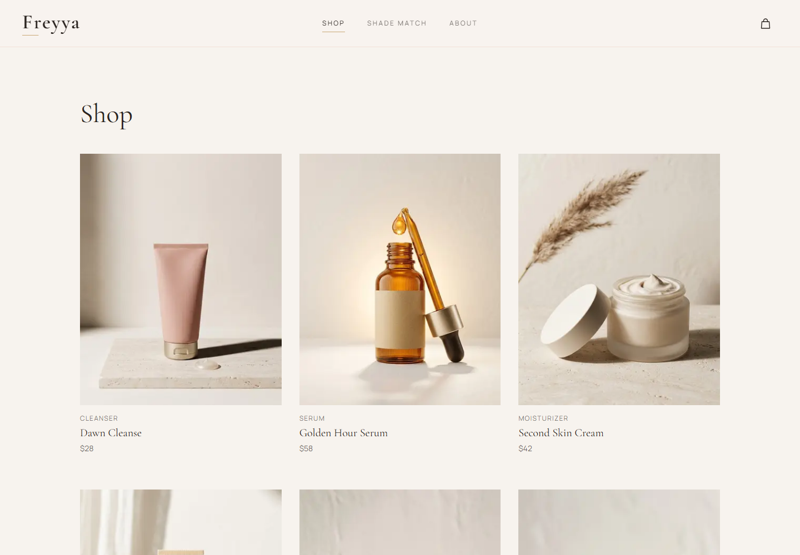
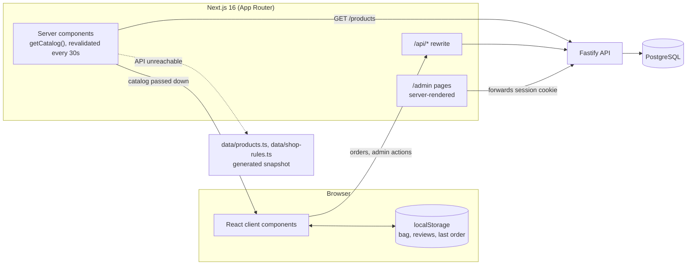
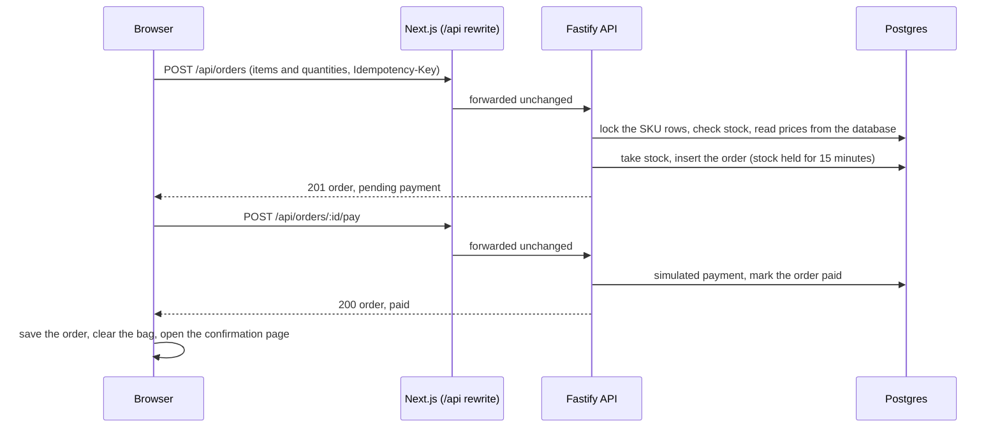

# Freyya

[](https://github.com/alieldeenahmed/Freyya/actions/workflows/ci.yml)

**A luxury skincare storefront, built as a frontend engineering and product design project, with a real API and admin dashboard behind it.**

Freyya sells six products in a calm, editorial interface: scroll-driven product stories, a shade-matching quiz, a persistent bag, and a checkout that places real orders against a backend. Payment is simulated. Everything else, including stock, orders and the admin, runs against a real database when the API is running.


## Overview

Freyya is a small e-commerce experience for an invented skincare brand. Its main job is to show what a polished, production-style storefront takes to build: a consistent visual system, deliberate motion, state that survives reloads, accessible interaction patterns, and a checkout that copes with things going wrong.

What it demonstrates:

- **Frontend engineering.** Next.js App Router, React 19 and strict TypeScript, with a hand-built design system on Tailwind CSS 4 and no component library.
- **Interaction design.** GSAP and Lenis for scroll-driven sections, a shared-element transition between the shop and product pages, and micro-interactions that all switch off for visitors who ask for reduced motion.
- **Product thinking.** A shade quiz, stock-aware product pages, a bag that re-checks itself against the catalog, and error messages written for shoppers, not developers.
- **A working backend.** An API that prices orders on the server, cannot oversell stock, and survives retried requests, plus an admin dashboard to run the shop.

It is a portfolio project, not a hosted business: nothing is really charged, nobody ships the orders, and no emails are sent.

## Live Demo

**https://freyya.vercel.app/**

The storefront is deployed on Vercel. **The API is not deployed**, so this deployment has no backend behind it (`/api/*` requests fail on the live site). The site knows this: it shows the bundled catalog, and its checkout page says plainly that this copy cannot place orders, instead of letting a visitor fill in the form and fail on the last click. In practice:

- Browsing works: the shop, product pages, the Shade Match quiz, the bag, the About and policy pages. The catalog comes from the generated snapshot in `Frontend/data/products.ts`.
- Placing an order and signing in to `/admin` do not work there. To see them, run the project locally (see [Getting Started](#getting-started)). The admin screenshots below come from a local run.

## Screenshots

| Shop | Product |
| --- | --- |
|  |  |


**Admin dashboard** (local run, demo data)

| Overview | Orders |
| --- | --- |
|  |  |


## Key Features

**Storefront**

- **Home.** A hero, then three scroll-driven product sections. Each one pins a product image in place with CSS `position: sticky` while a scrubbed GSAP timeline crossfades three photographs ("The formula", "The texture", "The finish"), then a brand-values section.
- **Shop.** Filter by *All / Skincare / Color* and sort by featured, price or name. The choice lives in the URL (`/shop?group=color&sort=price-asc`), so it survives a reload and can be shared. Unknown values fall back to the default view.
- **Product pages.** Shade swatches that cross-fade the gallery photo, a live stock line ("Only 3 left" at five or fewer, "Sold out" at zero), an accordion for ingredients, skin type, size and usage, an average rating that scrolls to the reviews, and related products.
- **Add to bag feedback.** A gold wipe sweeps across the button, the bag badge rolls to the new count, and a small self-dismissing note appears beside the bag. Nothing opens automatically and nothing needs closing.
- **Reviews.** 32 seeded reviews plus a form to write your own: a keyboard-operable star picker, validation, and a cap on lengths. Your reviews are saved in your browser and merged into the list and the average.
- **Shade Match.** Five questions that resolve to one shade of the lip balm or the glow drops. See [Shade Match](#shade-match).
- **Bag.** A drawer that behaves like a real modal dialog, with quantities capped at stock and a free-shipping hint.
- **Checkout.** Contact, delivery and shipping method, sent to the API. See [Commerce](#product--commerce-architecture).
- **Content and policy pages.** About, contact, shipping and returns, privacy, terms. The shipping page reads its prices and countries from the same module the checkout uses, so the two cannot disagree.
- **Small pieces.** A custom, keyboard-accessible dropdown used in four places, a footer newsletter field (demo-only), and custom 404, error and loading pages.

**Admin dashboard (`/admin`)**

- An overview with revenue, orders by status and low-stock items.
- An orders list with status filters, search and paging, and an order detail page with a timeline.
- Status actions that follow the order lifecycle (paid, shipped, delivered), plus cancel, which returns the stock to the shelf.
- Inventory: restock or correct any item, and read its history of changes (the latest 50 per item), each with the reason, the note, who made it, and a link to the order that caused it.

## User Experience

1. **Arrive.** The hero text animates in with a CSS animation that starts on the first paint, so it does not flash before it animates.
2. **Browse.** Scroll the home page's product stories, or open the shop and filter or sort.
3. **Inspect.** Click a product card. The card's photograph travels to its place on the product page instead of the page simply changing.
4. **Choose a shade.** Pick a swatch, or take the Shade Match quiz to be pointed to one.
5. **Add to bag.** The button confirms with the gold wipe, and the bag badge updates.
6. **Review the bag.** Open the drawer to change quantities or remove items. Refreshing the page, or opening a second tab, keeps the bag.
7. **Check out.** Fill in the form. If stock ran out in the meantime, the page says how many are left and corrects the bag.
8. **Confirm.** The confirmation page shows the order number, address and totals, and it still works after a refresh.

## Technical Architecture



- The **browser never calls the API directly**. Actions go to `/api/*` on the storefront's own address, and `next.config.ts` rewrites those requests to the API. That keeps the admin session cookie same-origin.
- **Server components fetch the catalog** and hand it to the browser through a context provider. If the API does not answer within four seconds, they fall back to the generated snapshot so the site still opens, and the provider records that the catalog is not live.
- **The bag, your reviews and the last order live in `localStorage`**, not on the server.
- **Admin pages render on the server** and call the admin API with the visitor's session cookie. Without a session they redirect to the sign-in page and render no data.

How a checkout travels:



## Data Ownership

The shop's data lives in more than one place because the storefront has to keep working when the API cannot be reached, as it does on the public deployment. So the question is not how to have one copy. It is which copy is the truth, and what stops the others from drifting.

| Data | Owner | Where it lives | Other copies | How they stay honest |
| --- | --- | --- | --- | --- |
| Products, prices, shades, launch stock | The API | `Backend/src/db/seed-data.ts`, then Postgres | `Frontend/data/products.ts` | **Generated** from the seed file by `npm run sync:data`. A test and CI fail if it is out of date or has been edited by hand |
| Shipping methods and prices, the free-shipping threshold, the countries, the limit per item | The API | `Backend/src/domain/pricing.ts` | `Frontend/data/shop-rules.ts` | **Generated** the same way. `lib/shipping.ts` and `lib/cart-store.ts` import it, and a test fails if either writes a number of its own |
| Live stock, orders, order status, the stock ledger | Postgres, through the API | The database | None. The browser keeps only the last order it placed, for the confirmation page | Nothing to keep in step |
| The bag | The visitor's browser | `localStorage` | None | Checked against the catalog every time it is read |
| Reviews | The visitor's browser | `localStorage`, on top of seeded reviews in `data/reviews.ts` | None | Not stored on a server. Said so in the interface and here |
| The catalog the tests use | The storefront's tests | They run against the snapshot | | They pin numbers from it, such as 24 in stock, so changing launch stock in the API means updating the tests. That is a useful alarm, not a leak |

The rules that follow from this:

- **The browser never asks the API for anything directly.** Every call goes to `/api/*` on the storefront's own address, which Next rewrites to the API.
- **The API is the only thing that decides a price or a total.** The storefront shows a preview with the same rules, so a shopper sees the cost before they commit, but the order it places carries only items and quantities. What the confirmation page shows is what the API answered.
- **With no API, the storefront says so.** It shows the snapshot, and its checkout page states that this copy cannot place orders. It does not let a shopper fill in a form and fail on the last click without explanation.
- **The packages can still be deployed alone.** The only coupling is the generation step, which happens while developing, not while running. Nothing in the storefront imports from the API at runtime.
- **Changing the catalog is one command.** Edit `Backend/src/db/seed-data.ts` or `pricing.ts`, run `npm run sync:data`, and commit both. If the second step is forgotten, CI says exactly what to run.

## Correctness Guarantees

What the API promises, and the tests that would fail if it stopped. All of them run against a real Postgres database, since a mock cannot show a lock being taken.

**Stock is never negative and never invented.** Placing an order locks the rows for its items in a fixed order, checks the stock, and takes it, in one transaction. A single function changes stock, and it writes a row to a ledger each time. The database also refuses a negative count. After every race below, the tests check the same rule: each item's stock equals the sum of its ledger, and is not below zero.

- Ten buyers for three units: exactly three orders succeed.
- Eight buyers and three admin adjustments on one item at the same time: the final stock equals the start, plus the adjustments that were accepted, minus the orders that were placed.
- Twenty admin removals of one unit each from an item with ten: exactly ten are accepted and ten are refused.
- Twelve orders, each then paid, cancelled or both at once: the books balance, and the stock held equals the orders still standing.

**A retry is safe, and a mistaken retry is refused.** An order carries an `Idempotency-Key`. Ten identical requests arriving together make one order and take the stock once. A repeat after the order was paid returns it as paid, and after it was cancelled returns it as cancelled, taking nothing again. Using the same key for a *different* order is refused with `422 idempotency_key_reused`, because quietly returning the old order would tell a shopper their new cart had been ordered. The API compares a fingerprint of the buyer, address, shipping method and merged items.

**Held stock is released once, and never blocks a buyer.** An unpaid order holds its stock for 15 minutes. A sweep gives it back, and placing an order also releases any hold that has run out before checking stock, so nobody is turned away because the sweep has not come round yet. A payment and the sweep arriving together release the stock once, and two sweeps together do the same.

**Order status follows one table.** Every pair of statuses (36 of them) is checked through the real API. Only cancelling returns stock. A refund does not, because shipped goods may not be resellable. Ten cancellations at once cancel once. Shipping and cancelling together let exactly one win, and the stock agrees with the winner. No route lets a customer change a status, and a status or a timestamp in a request body is ignored.

**Bad input is refused, not trusted.** Quantities of 0, -1, 1.5, "2", null, true, 11 and a billion are all refused, as are 21 lines, an item split across lines to get round the limit of ten, a text field with a NUL character (which Postgres cannot store and which used to cause a 500), an id that could not exist, and a request body of two megabytes. Prices, totals and statuses sent by the client are ignored.

**The admin is protected everywhere.** A test walks every route the API has registered and checks that each is either on a short list of open routes or answers `401` before it reads anything else. Adding a route without choosing which list it belongs on fails the test. See the API's own README for the cookie, rate-limit and cache details.

**Not guaranteed.** Everything rests on one Postgres database. Hold expiry uses the API server's clock, so several servers with different clocks are not accounted for. Payment is simulated, so there is no real double-charge case to test.

## Frontend Architecture

- **Framework.** Next.js 16.3 with the App Router and React 19. Turbopack is the default toolchain in this version. There is no Vite.
- **Routing.** 16 routes under `Frontend/app`: the storefront (`/`, `/shop`, `/shop/[id]`, `/quiz`, `/about`, `/checkout`, `/checkout/confirmation`, `/contact`, `/privacy`, `/terms`, `/shipping-returns`) and the admin (`/admin`, `/admin/login`, `/admin/orders`, `/admin/orders/[id]`, `/admin/inventory`). Custom `not-found`, `error`, `global-error` and `loading` files.
- **Server and client split.** Pages, the catalog, the footer, metadata and the admin are server components. Anything with state or animation is a client component.
- **State management.** No state library. There are three kinds of state:
  - *Catalog:* fetched on the server, exposed through `CatalogProvider` and `useCatalog()`.
  - *Persistent browser state:* the bag (`freyya:cart`), your reviews (`freyya:reviews`) and the last order (`freyya:last-order`), each a small module read with `useSyncExternalStore`. Each returns the same cached value until the stored value changes, so React sees a stable snapshot. They sync across tabs through the `storage` event and fall back to memory if storage is blocked.
  - *Local UI state:* ordinary `useState` for forms, the quiz, drawers and menus.
- **Data handling.** `lib/catalog.ts` fetches and validates the catalog. `lib/api.ts` is a small typed client. It gives every request a timeout, and turns every way a call can fail into one `ApiError` with a stable code: the API's own codes, or `network_error`, `timeout` or `unavailable` (for the plain error page a proxy returns when the API is down). `lib/checkout.ts` turns each of those into a message and a fix, and never trusts the shape of an error it is given, because it runs in the error path.
- **Reusable pieces.** `Reveal` (scroll-triggered fade-in), `FadeImage`, `Field` and `fieldClass` (form inputs), `Select` (dropdown), `PolicyPage`, `ProductCard`, `ProductGrid`, `OrderSummary`, `StatusBadge`, and hooks such as `useMagnetic` and `useHydrated`.
- **Quality tooling.** Strict TypeScript, ESLint with `eslint-config-next`, Vitest with Testing Library, Playwright with axe, and CI on GitHub Actions.

## UI / Design System

The design system is a set of tokens plus conventions, written directly in Tailwind CSS 4 with no UI library.

- **Colour tokens** (`app/globals.css`, exposed through `@theme`): base `#f7f3ee`, accent gold `#c9a876`, a deeper gold `#7f6030` for small text (the brand gold is too pale to read on the cream base), secondary blush `#e8c4b8`, text `#2b2420`. Gold is kept for lines, fills and hover states.
- **Typography.** Cormorant Garamond (400, 500, 600) for headings, prices and product names, and Manrope for interface text, both loaded through `next/font` and exposed as `font-serif` and `font-sans`. Small labels are uppercase with wide letter-spacing.
- **Surfaces.** Hairline borders (`border-secondary/40`), flat cards, no rounded corners on containers, and a soft shadow reserved for floating panels.
- **Interactive patterns.** Solid dark buttons that turn gold on hover, outlined secondary buttons, underline-style form fields, and a single focus style: a 1px gold outline with an offset.
- **Placeholders.** A `.skeleton` class with a shimmer, shown behind every photograph until it loads.
- **Motion.** Eased movements over short distances (typically 8 to 24 pixels of travel). Every animation is gated by `prefersReducedMotion()` in JavaScript or a `prefers-reduced-motion` rule in CSS.
- **Lining numerals in admin.** Cormorant's default old-style figures make a "1" look like an "I", so dashboard figures use `lining-nums`.

## Product / Commerce Architecture

**Product model** (`lib/types.ts`). A `Product` has an id, name, category (`Cleanser`, `Serum`, `Moisturizer`, `SPF`, `Lip Balm`, `Highlighter`), tagline, description, price, specs, a brand colour, images, `details` (ingredients, skin types, size, usage) and related product ids. Products with shades have `variants`, each with a hex colour, image, stock, `undertone` (cool, warm, neutral) and `intensity` (subtle, bold). Stock lives on the product, or on each variant when there are shades.

The catalog is six products and twelve stock-keeping units: four single products, plus the balm and the glow drops with four shades each.

**The bag** (`lib/cart-store.ts`, `lib/cart-context.tsx`). A line is `{ id, productId, variantId?, name, variantName?, price, color, image, stock, quantity }`. The line `id` is `productId` for a plain product and `productId:variantId` for a shade, and the same id is the stock key the API uses.

- `reconcileCart(items, catalog)` is a pure function that re-derives name, price, image and stock from the current catalog, drops unknown products and shades, and clamps each quantity between one and the available stock. It runs every time the bag is read, so a saved bag can never carry an outdated or tampered price.
- `withAdded`, `withQuantity` and `withoutItem` are pure functions that return a new list.
- `CartProvider` combines the stored lines with the catalog from `useCatalog()`.

**Money and shipping.** Prices are whole dollars in the browser. The API stores integer cents and returns dollars. Standard shipping is $6 and free from $75, and express is $14 (`lib/shipping.ts`). The browser calculates totals for display, and the server recalculates them, so its figures are the ones that count.

**Checkout.** The form is validated in the browser, then sent as items and quantities only, with an `Idempotency-Key` that changes whenever the shopper edits anything. Server errors map to fixes:

| Server answer | What the shopper sees |
| --- | --- |
| Not enough stock | "Golden Hour Serum: only 1 left." The bag is corrected to match. |
| Item no longer sold | It is removed from the bag, with an explanation. |
| Field validation | The message appears on the field it belongs to. |
| Rate limited, or connection lost | A plain retry message. The same key is reused, so a retry cannot create a second order. |

The confirmation page reads the last order from `localStorage`. With no order saved, it redirects to `/shop`.

## Shade Match

A five-question quiz at `/quiz` (nav label "Shade Match"). Logic is in `lib/quiz.ts`, and the interface is `components/Quiz.tsx`.

1. **Which product.** Freyya Balm (tinted lip balm) or Dew Drops (glow drops).
2. **Three undertone clues.** Wrist vein colour, jewellery metal, and how skin reacts to sun. Each answer votes for *cool*, *warm* or *neutral*.
3. **Intensity.** Barely there (*subtle*) or noticeable (*bold*).

`scoreQuiz(answers, products)` tallies the three undertone votes and takes the largest. Ties resolve in the order cool, warm, neutral. It then looks in the chosen product's variants for the winning undertone and intensity. If that exact combination does not exist (there is no bold cool Dew Drops shade, for example), it falls back to the same undertone at the other intensity, then to the product's first shade. Missing answers default to the balm, subtle.

The component keeps the step and answers in local state, derives the result during render, animates each step in and out with GSAP, and shows the matched shade's photograph with a link to that product's page. It reads the catalog from `useCatalog()`, so the result reflects the live catalog.

The result links to the product page but does not pre-select the shade there. All 108 answer combinations are covered by a test that asserts each resolves to a shade that exists.

## Responsive Design

The layout is mobile-first and uses two Tailwind breakpoints: `sm` (640px) and `lg` (1024px). There is no separate tablet layout, so tablets use the `sm` layout until 1024px.

| Width | What changes |
| --- | --- |
| Below 640px | Single column. The header shows a menu button that opens a nav panel. The product grid is one column, and the product page stacks photo above text. The bag drawer is full width, up to a maximum of 384px. The admin's tables become cards. |
| 640px and up | The header becomes a three-column grid with inline navigation. The shop grid is two columns, the product page is two columns with the photo sticky beside the text, and forms use two-column rows. |
| 1024px and up | The shop grid is three columns. Checkout adds a 400px order-summary column that stays in view, and the order confirmation adds a 400px summary column. |

**What the audit measured.** Every storefront page and the admin were loaded at 320, 375, 768, 1024, 1440 and 1920 pixels, checking for anything that scrolls the page sideways, anything poking past the edge, and every control smaller than 40 pixels. Screenshots of the header, shop, product, checkout, quiz, menu and bag were read at each size. Nothing overflowed at any width, so no breakpoint was added: the two that exist held up, and a tablet layout would have been a cost without a problem to solve. The audit did find, and the changes fixed:

- **The admin inventory hid its buttons on a phone.** The table was 36rem wide inside a scroller, so at 375px the Adjust and History buttons sat off-screen with nothing to say the table scrolled. The inventory and orders tables now become cards below 640px, with the table roles written out so a screen reader still hears a table. The stock history rows wrap too.
- **Undersized tap targets.** The newsletter button (35 pixels wide), the tablet navigation (32 tall), the rating, "Back to shop", "Keep shopping", "Cancel", "Show all reviews", "Got it", "View bag" (16 to 20 tall) and the star radios (36) are now at least 40 pixels, without changing how the page looks: the underlines stay under the text.
- **Five stars and their label could not fit a 320 pixel screen** once the stars were made bigger, so they wrap.

Other techniques used:

- The hero uses `dvh` units, so it fits mobile browser chrome.
- `next/image` `sizes` attributes match the layout's real column widths.
- Icon buttons are 44 by 44 pixels.
- The header is sticky, and the mobile nav panel is animated with GSAP.
- At 1920 pixels the content stays in a centred column of a readable width instead of stretching. That is a design choice, and it leaves wide margins on the largest screens.

These checks are permanent tests in `Frontend/e2e/responsive.spec.ts`.

## Accessibility

Built for screen readers and keyboards, and checked with automated tests of the accessibility tree, focus and announcements (see below). Nobody has yet listened to the site with a real screen reader such as NVDA or VoiceOver, so no compliance claim is made.

- A skip-to-content link, `aria-current="page"` on the active nav link, one `main` landmark, and named navigations.
- **The bag button says how many items it holds** ("Cart, 2 items"). Adding an item is announced ("Freyya Balm, Petal, added to your bag") through a live region that is always on the page, because a region that starts out hidden is unreliable.
- **The bag drawer is a `role="dialog"` with `aria-modal`.** Opening it moves focus in, traps Tab, closes on Escape, marks the rest of the page `inert`, stops smooth scrolling and locks page scroll, and returns focus to the bag button on close. Items are a list. A quantity change or removal is announced with the product's name, and removing an item keeps focus inside the drawer instead of dropping it.
- **Forms.** Every field has a label. Errors use `role="alert"`, `aria-invalid` and `aria-describedby`. The checkout, contact, newsletter and review forms move focus to the first invalid field on submit. When the contact or newsletter form is sent, focus moves to the thank-you, since the form it was in is gone.
- **The star picker** is a `role="radiogroup"` where the arrow keys move focus and choose together, as a native radio group does. Displayed ratings are `role="img"` with a text label. The rating breakdown reads as sentences ("3 reviews with 5 stars"), not bare numbers.
- **Shade Match** moves focus to each new question and to the result, because the button just pressed disappears. Its answers are a group named by the question.
- **Shade swatches** are a group named by the shade label, and say which is pressed and which are sold out. Photographs of shades that are not showing are hidden from readers, and the stock line is announced when the shade changes.
- **The custom `Select`** is a listbox: `aria-haspopup`, `aria-expanded`, `aria-controls`, `aria-activedescendant`, arrow keys, Home and End, type-to-jump, and Escape.
- **The accordion** names each panel by its button, and closed panels are `inert`, so their text is not read and their contents cannot be tabbed to. Filter chips use `aria-pressed`.
- **The mobile menu** closes on Escape and hands focus back to its button.
- **The admin** gives each row's buttons the item's name ("Adjust stock, Second Skin Cream"), moves focus into and out of the stock form, asks before cancelling with the safe answer focused, and announces the result of an order change.
- Product cards are named once, by their heading. Their photographs are decorative.
- Images otherwise have descriptive `alt` text, or an empty one when purely decorative.
- **Reduced motion** is respected across GSAP (`prefersReducedMotion()`), CSS (`prefers-reduced-motion` and `motion-reduce:`), and smooth scrolling, which is not started at all.
- **Focus is easy to find.** The keyboard focus ring is 2 pixels of the deep gold, about 5:1 against the cream. It used to be 1 pixel of the brand gold, about 2:1, which is below the 3:1 that WCAG asks of focus indicators. Fields show focus as a thicker underline in the same colour.
- **Controls are tap-sized.** Everything a shopper presses on a phone is at least 40 pixels each way, checked in the tests.
- Text tones were checked against WCAG AA contrast ratios during development, which is why a separate deeper gold exists for small text. This was a calculation, not a formal audit.

**Automated checks.** Three kinds, all run in CI:

- **axe scans** of every page and the key interactive states, against the WCAG 2.0, 2.1 and 2.2 A and AA rules plus axe's best-practice rules. The states are the open bag drawer, an open dropdown, the review form, a quiz result, checkout with errors showing, and the admin pages. All pass, and a separate test proves the scanner reports real problems.
- **Accessibility-tree and focus tests** in a real browser, which check names, states, landmarks and where focus lands after each action.
- **Component tests** for the same behaviour, so a regression fails in seconds.

These read the information a screen reader is built from. They cannot tell whether an announcement is helpful or the reading order is pleasant. That takes a person with a screen reader, which has not been done, and [`docs/accessibility-testing.md`](docs/accessibility-testing.md) is the checklist for it.

## Performance

- **Images.** `next/image` with `sizes` attributes matched to the layout, and `priority` on the hero, the first three product cards, the first product photo and the About photo.
- **No blank images before hydration.** `FadeImage` renders photographs visible in the server HTML, and only hides and fades one in if it is still downloading when React hydrates. A commit in the history (`perf: show images before hydration…`) records this change.
- **Fonts.** Loaded through `next/font`, which self-hosts them.
- **Rendering.** The catalog fetch is cached and revalidated every 30 seconds, so the storefront pages are statically generated and refreshed in the background. The admin is the only dynamic part.
- **Layout stability.** The Suspense fallback on the shop renders the same markup as the real controls, the checkout pages reserve their height, and the hero text animates from CSS from the first paint.
- **Animation hygiene.** GSAP work is wrapped in `gsap.context()` and reverted on cleanup. Lenis is kept in sync with the page height through a `ResizeObserver`.

**Measured, with a budget.** A first visit downloads about 202 KB of gzipped JavaScript on the home page and 209 KB on a product page, of which 128 KB is React and the Next.js router. The rest is mostly GSAP with ScrollTrigger, which loads on every page. `npm run perf` reads the production build and fails CI if a page grows past its budget in `Frontend/perf-budget.json`. [`docs/performance.md`](docs/performance.md) has the baseline, where the bytes are, and what was found and deliberately left alone.

Lighthouse was run locally during development and its results are recorded in [`Frontend/README.md`](Frontend/README.md). There is no Lighthouse run in CI, and no measurement of real visitors.

## Testing

Three layers, and CI runs all of them. **Storefront: 243 tests in 18 files. API: 249 tests in 9 files. End to end: 111 tests in 8 files.**

```bash
npm test                # storefront and API tests
npm run test:e2e        # end-to-end tests (needs Backend/.env.test)
```

### Storefront (Vitest, `Frontend/tests`)

Logic tests run in Node. Component tests render the real components in jsdom with Testing Library and a mocked network.

| Area | What is checked |
| --- | --- |
| Shade Match | All eight shade outcomes, ties, fallbacks, defaults, and every one of the 108 answer combinations. The quiz component is tested from the first question to the result. |
| The bag | Stock limits per shade, the limit of ten per order, persistence across a reload, and recovery from a saved bag that is tampered with, from an older version, has duplicate lines, has ids that no longer match, or has quantities such as 0, -3, 0.2 and a billion. Merged duplicates, sold-out items and cut-back quantities are explained to the shopper in words. The drawer is tested as a modal: focus trap, Escape, inert background, announcements. |
| Checkout | Request building. The form end to end against a mocked API. Every failure a shopper can meet: the store unreachable, timing out, answering with an HTML error page, rate limiting, a stock refusal, an order closed before payment, a request key reused, and details that are malformed. Each is shown as a plain message, leaves the bag alone, and lets the shopper retry. Retries reuse the same request key, and changing anything starts a new one. |
| The API client | Timeouts, dropped connections, an HTML page where JSON was expected, a success that is not JSON, and the API's own error codes passed through. |
| Shop, product page, reviews | Filtering, sorting and the URL. Shade swatches, stock lines and the limit message. Star rating and review validation. The accordion and the custom dropdown's keyboard behaviour. |
| Screen readers | Names, landmarks, announcements and where focus lands after each action, across the header, bag, quiz, reviews and forms. |

### API (Vitest, `Backend/tests`, real Postgres)

| File | What is checked |
| --- | --- |
| `orders`, `catalog`, `pricing`, `auth`, `admin` | Ordering, pricing, stock, expiry, sign-in, sessions, order transitions and stock adjustments, one path at a time |
| `concurrency` | The races: buyers against buyers, buyers against admin adjustments, orders against the expiry sweep, payments against cancellations, ten identical requests at once, the same key with a different order, and dozens of kinds of malformed input. After each, the stock ledger must still balance |
| `order-state-machine` | All 36 status pairs through the API, the side effects on stock, and every way a customer might try to change a status |
| `security` | Every route is open or protected on purpose. Cookie flags. Origin checks. Sign-in limits. No data in refusals. `no-store` on personal data. Hostile ids and NUL characters. Nothing from the environment in any response |
| `contract` | The storefront's generated snapshot matches the API's files exactly, and the storefront's code writes no rule of its own |

The API tests wipe their tables, so they run on a separate database and refuse to run if it matches `DATABASE_URL`. See [`Backend/README.md`](Backend/README.md#tests).

### End to end (Playwright, `Frontend/e2e`)

Against a production build of the storefront, the real API and a throwaway database, on desktop Chrome and a 375 pixel phone. Each spec is a journey a person would take:

| Spec | Journey |
| --- | --- |
| `journeys` | **A.** Home, shop, product, shade, bag, reload, checkout, confirmation, with the stock checked in the database afterwards. **B.** Stock that runs out: the button and drawer stop at the stock, and at ten of an item however much is in stock. A bag from an earlier visit is cut back with an explanation. Someone else buys the last units while the shopper is typing, and the shopper is told and gets the last one. **C.** The store fails during checkout, four ways: unreachable, a gateway error page, rate limited, and the payment step dropping after the order was made. Each is explained, the bag is kept, and the retry reuses the same request key and makes one order. **D.** The admin's session ends mid-task and they are sent to sign in, with nothing changed |
| `checkout`, `storefront` | A real purchase, a refused order, validation, the shop, the quiz and the bag |
| `admin` | Signing in, shipping an order, cancelling one and seeing its stock return, restocking, refusing negative stock |
| `responsive` | No sideways scrolling on any page at 320, 375, 768, 1024 and 1920 pixels. Tap-sized controls on a phone. The admin tables as cards |
| `accessibility` | axe scans of every page and the main interactive states |
| `screen-reader` | Names, states and focus in the browser's accessibility tree |
| `seo` | Titles, canonical addresses, share previews, robots.txt, the sitemap, structured data, real 404s, and every internal link on every page |

### CI

`.github/workflows/ci.yml` runs on every push to `main` and every pull request:

- **Storefront:** lint, type-check, tests, a production build with fake values in the server-only settings, a scan proving none of them reached a file a browser downloads, and the performance budget.
- **API:** type-check, build, a check that the storefront's snapshot is up to date, migrations on an empty Postgres, and the tests.
- **End to end:** after the two above pass, the whole Playwright suite. The report is kept if it fails.

The first run on GitHub failed for a real reason that only showed up there: the lockfile had been written by a newer npm than the one on GitHub's runners, which wanted two packages it did not list. Once that was fixed, all three jobs passed on GitHub's Linux runners, including the end-to-end suite in the browser Playwright installs. The checks added since then have been run locally and have not yet been run by GitHub. There is no automatic deployment: Vercel deploys the storefront through its own free integration.

Not covered: a manual screen-reader pass, real-device testing beyond the emulated phone, and load testing.

## Project Structure

```text
Freyya/
├── Frontend/                Next.js storefront and admin
│   ├── app/                 Routes, metadata, share images, sitemap, robots
│   │   └── admin/           Admin dashboard pages
│   ├── components/          UI components
│   │   └── admin/           Admin UI
│   ├── lib/                 Catalog, bag, checkout, quiz, shop view, API client
│   ├── data/                Generated snapshot of the API's catalog and shop rules, seeded reviews
│   ├── tests/               Logic and component tests (Vitest)
│   ├── e2e/                 End-to-end, accessibility, SEO and layout tests (Playwright)
│   ├── scripts/             Bundle size report and the client-bundle secret scan
│   ├── public/              Product and hero photography
│   ├── assets/fonts/        Fonts used to draw share images and icons
│   └── docs/screenshots/    Storefront screenshots
├── Backend/                 Fastify API
│   ├── src/                 Routes, services, domain rules, database
│   ├── drizzle/             Generated SQL migrations
│   ├── tests/               Integration and unit tests
│   └── scripts/             Admin password helper, and the generator for the storefront's snapshot
├── .github/workflows/       CI
├── docs/                    Admin screenshots, accessibility checklist, performance baseline
└── package.json             Root scripts that drive both packages
```

## Tech Stack

| Technology | Purpose |
| --- | --- |
| Next.js 16, React 19 | Storefront and admin (App Router, server components, Turbopack) |
| TypeScript (strict) | Both packages |
| Tailwind CSS 4 | Styling and design tokens |
| GSAP (ScrollTrigger, Flip) | Scroll-driven sections, shared-element transition, micro-interactions |
| Lenis | Smooth scrolling |
| Fastify 5 | API |
| Drizzle ORM, `pg` | Database access and SQL migrations |
| PostgreSQL | Data (developed against Neon) |
| Zod | Request and environment validation |
| Vitest, Testing Library, jsdom | Unit, integration and component tests |
| Playwright, axe-core | End-to-end tests and automated accessibility scans |
| GitHub Actions | CI |
| ESLint (`eslint-config-next`) | Storefront linting |

The storefront's only runtime dependencies are `next`, `react`, `react-dom`, `gsap` and `lenis`.

## Engineering Decisions

| Decision | Why it appears to have been made | Trade-off |
| --- | --- | --- |
| Catalog comes from the API, with a generated snapshot as fallback | The site should stay browsable if the API is down, as it is on the public deployment. | The snapshot can show stock that is out of date. It is generated from the API's own files and CI fails if it is stale, and its checkout page says when orders cannot be placed. |
| Bag re-checked against the catalog on every read | A comment says a saved bag must never carry an outdated price, image or stock level. | The catalog has to be available in the browser, which is why it goes through a context provider. |
| Browser calls `/api/*` and Next rewrites it to the API | A comment in `next.config.ts` says this keeps the admin cookie same-origin. | The storefront host needs the API address at build time. |
| Local stores read through `useSyncExternalStore` with cached snapshots | The code keeps the same value until the stored one changes, which is what `useSyncExternalStore` needs for a stable snapshot, and it adds cross-tab sync through the `storage` event. The comments give no further reason. | A small amount of hand-written store code, repeated for three stores. |
| Shop-to-product transition uses a "ghost" copy and `Flip.fit` | A comment says a fixed copy means the grid never reflows and the text column stays put. | It is bespoke code that has to handle slow image loads and reduced motion. |
| Custom `Select` instead of the browser's | Branded, consistent dropdowns (commit: "replace native dropdowns with a branded select"). | Browser autofill no longer fills the country field, and keyboard and screen-reader behaviour is now code to maintain. |
| Simulated payment behind a `PaymentProvider` interface | A comment marks it as the seam for a real provider. | The most visible part of a real checkout is faked. |
| The API sets prices, and the browser sends only items and quantities | Tests and comments assert that client prices are ignored. | Prices and totals shown before ordering are a preview, using rules generated from the API's. |
| Showcase sections use CSS `sticky` plus a scrubbed timeline | The git history shows an earlier version used a GSAP pin, replaced during a "responsive and performance pass". The commits do not record why. | The section height is set from JavaScript. |

## Challenges & Solutions

- **Smooth scroll fought client-side navigation.** Lenis caches the page height, so a page that changed length after a navigation could not be scrolled. The fix is a `ResizeObserver` on `<body>` that re-measures, plus a scroll reset on every route change.
- **A shared-element transition that never flashes.** Moving a card's photograph to the product page had to hide the real image until the copy landed, wait for the real image to load, and skip entirely for reduced motion or a stale record (older than four seconds). The card writes its position to `sessionStorage`, and the product page reads it before paint.
- **Stock changes between page load and checkout.** The catalog can be up to 30 seconds old. Rather than trusting it, the server re-checks stock and returns exactly what is available, and the bag is corrected to match.
- **Double submits and dropped connections.** Each attempt carries an idempotency key that resets when the form changes, and the API returns the original order for a repeated key, even when two identical requests arrive at once.
- **Two people buying the last unit.** The API locks the stock rows in a fixed order inside one transaction, and the database itself refuses a negative count. A test covers it.
- **localStorage data on a server-rendered page.** The checkout renders only its heading until the browser has hydrated (`useHydrated`), so the empty-bag message is not shown before the saved bag has been read.
- **A modal that really is modal.** The drawer makes the rest of the page `inert`, traps focus, stops smooth scrolling, and restores all of it on close.
- **Layout shift from a client-only filter.** The shop's Suspense fallback renders the same controls as the real component.
- **A 404 page that answered 200.** The end-to-end tests found that an unknown product address showed the not-found design but returned HTTP 200, a "soft 404" for search engines. Once a response has started streaming its status cannot change. The fix is `dynamicParams = false` on the product route, so an unknown id is a real 404. The trade-off is that a product added after the last build has no page until the storefront is rebuilt. A test guards the 404.
- **A retry that returned the wrong order.** The API answered a repeated idempotency key with the order it had first made, even when the new request was for a different cart. A client bug would have shown a shopper a confirmation for something they had not ordered. The API now remembers a fingerprint of each keyed order and refuses a mismatch with a clear code, with a test for the race where two different carts arrive with one key.
- **Stock held by an order nobody paid for.** An expired hold still counted as taken until a sweep, once a minute, gave it back, so a buyer could be told an item was sold out that was not. Placing an order now releases expired holds first.
- **The storefront and the API disagreed about how many you can buy.** The API takes at most 10 of an item, but the bag allowed as many as were in stock, so a shopper with 24 in their bag got "Please check the highlighted fields" with no field highlighted. The limit is now one number, generated from the API, that the bag enforces and explains.
- **A NUL character was a 500.** `/products/%00` and a name containing a NUL both reached Postgres, which cannot store one. Ids and text are now checked before the database, and a test tries hostile values on every route.
- **A bag that shrinks in silence.** Items that sold out or were withdrawn used to vanish from the bag with no explanation. It now says what changed and why, and a saved bag with duplicate lines, old-style ids or absurd quantities is repaired rather than trusted.
- **A focus ring nobody could see.** The keyboard focus outline was the brand gold on cream, about 2:1. It is now the deep gold, about 5:1.
- **The add-to-bag feedback took three tries.** The history shows a fly-to-bag animation, then a gold-dust glide, then the current gold wipe with a rolling count and a note. The commits do not record the reasoning.

## Getting Started

**Prerequisites:** Node.js 22.9 or newer, which the API requires. The storefront on its own needs only what Next.js 16 supports, which is Node.js 20.9 or newer. The full stack also needs a Postgres database. [Neon](https://neon.tech) has a free tier.

```bash
git clone https://github.com/alieldeenahmed/Freyya.git
cd Freyya
```

### Storefront only

No database is needed. The catalog comes from the generated snapshot, and a warning about that appears in the terminal. Ordering and the admin will not work, and the checkout page says so.

```bash
cd Frontend
npm install
npm run dev
```

Open [http://localhost:3000](http://localhost:3000).

### Full stack

```bash
npm run install:all
```

Copy `Backend/.env.example` to `Backend/.env` and set `DATABASE_URL`. For the admin login, make a password hash, then put it in `ADMIN_PASSWORD_HASH` along with `ADMIN_EMAIL`:

```bash
npm run admin:hash -- "a password of at least 12 characters"
```

Create the tables, load the six products, and start both servers in two terminals:

```bash
npm run db:migrate     # run this again after pulling changes: migrations are additive
npm run db:seed
npm run dev:api        # API on http://localhost:4000
npm run dev:web        # storefront on http://localhost:3000
```

The admin is at [http://localhost:3000/admin](http://localhost:3000/admin).

### Commands

| Command | What it does |
| --- | --- |
| `npm run install:all` | Install both packages |
| `npm run dev:api`, `npm run dev:web` | Start the API, or the storefront |
| `npm run db:migrate`, `npm run db:seed` | Create tables, load the launch catalog (safe to repeat) |
| `npm run admin:hash` | Make a password hash for the admin login |
| `npm run sync:data` | Regenerate the storefront's snapshot of the catalog and shop rules from the API's files |
| `npm run sync:data:check` | Fail if that snapshot is out of date |
| `npm run typecheck` | Type-check both packages |
| `npm run lint` | Lint the storefront |
| `npm test` | Run the storefront and API tests (the API tests need `Backend/.env.test`) |
| `npm run test:e2e` | Run the end-to-end tests (needs `Backend/.env.test`) |
| `npm run build` | Build both packages |
| `npm --prefix Frontend run perf` | After a build: page weights against the budget |
| `npm --prefix Frontend run check:bundle` | After a build: check no server-only value reached the browser bundle |

To preview a production build of the storefront: `npm --prefix Frontend run build`, then `npm --prefix Frontend start`.

## Environment Variables

**Storefront** (`Frontend/.env.example`). All are optional for local development.

| Variable | Purpose |
| --- | --- |
| `API_URL` | Where the API runs. Default `http://localhost:4000`. Read when the app builds and starts. |
| `NEXT_PUBLIC_SITE_URL` | The public address, for the sitemap and share links. Falls back to the Vercel production URL, then to `http://localhost:3000`. |
| `NEXT_PUBLIC_CONTACT_EMAIL` | If set, the contact page also shows this address as a mail link. |

**API** (`Backend/.env.example`)

| Variable | Purpose |
| --- | --- |
| `DATABASE_URL` | Postgres connection string. Required. |
| `PORT`, `HOST` | Where to listen. Defaults `4000` and `0.0.0.0`. |
| `CORS_ORIGINS` | Origins allowed to call the API, comma-separated. Default `http://localhost:3000`. |
| `ADMIN_EMAIL`, `ADMIN_PASSWORD_HASH` | The single admin login. Without them, admin sign-in answers 503. |
| `ADMIN_SESSION_HOURS` | Admin session length. Default 12. |
| `RESERVATION_MINUTES` | How long unpaid stock is held. Default 15. |
| `LOW_STOCK_THRESHOLD` | At or below this, an item is flagged as low. Default 5. |
| `RATE_LIMIT` | On by default. The end-to-end run sets `false`, so its own sign-ins are not throttled. Leave it on elsewhere. |
| `TRUST_PROXY` | Set to `true` behind a proxy, so rate limits see real client addresses. |

`Backend/.env.test` (git-ignored) holds `TEST_DATABASE_URL` for the API tests. No secrets are committed: `.env` files are ignored, and only the `.env.example` files are tracked.

## Deployment

**Storefront, on Vercel.** Deployed at https://freyya.vercel.app/. The repository holds no platform configuration file. Import the repository, set the Root Directory to `Frontend`, and Vercel builds it. Nothing else is needed, because the storefront builds and runs with no API:

- **No API address set.** `API_URL` defaults to `http://localhost:4000`, which does not exist on Vercel. The catalog request fails at once, the build logs a line saying it is using the snapshot, and every page is generated from it. The build takes about a minute and prints `[catalog] using the bundled snapshot` many times. That is expected.
- **If the API address is set but does not answer,** the same happens after four seconds, so a dead host cannot hang a build or a page.
- **Setting `API_URL`** to a reachable API makes the pages use live data, refreshed every 30 seconds. It is read when the site builds, because it is baked into the `/api/*` rewrite, so change it and redeploy.
- **Setting `NEXT_PUBLIC_SITE_URL`** gives the sitemap, canonical addresses and share previews a custom domain. Without it they use Vercel's production address.
- **Server-only values never reach the browser.** Only `NEXT_PUBLIC_*` values are ever placed in browser files. CI builds with fake values for `API_URL`, `DATABASE_URL`, `ADMIN_EMAIL` and `ADMIN_PASSWORD_HASH`, then searches every file the browser downloads for them, and for the shape of a connection string, a password hash and a private key. It also fails if a planted leak is present, which was checked by planting one.
- **Routes.** Every internal link on every page in the sitemap is followed in the end-to-end tests, and an unknown address, or a product that did not exist at build time, is a real 404. That means a product added to the API after a build has no page until the storefront is rebuilt.

**Running with the local API.** For the full demonstration, run the API and the storefront on a machine, as in [Getting Started](#getting-started). The storefront needs `API_URL` (default `http://localhost:4000`), and the API needs `CORS_ORIGINS` set to the storefront's address. Nothing about the local setup requires paid hosting: the database can be a free Neon project.

**API.** Not deployed, which is why the live storefront has no backend. It is a plain Node service: build it with `npm run build`, run the migrations against the target database, then start it with `npm start`, with the environment variables above. Set `CORS_ORIGINS` to the storefront's address and `TRUST_PROXY=true` behind a proxy. See [`Backend/README.md`](Backend/README.md).

**CI** runs on GitHub Actions (see [Testing](#testing)). There is no automatic deployment.

## Current Status

A polished portfolio project with a working backend, not a hosted business.

- Payment is **simulated**. Nothing is charged, and no card details exist anywhere.
- Orders are real records with real stock effects, but nobody fulfils them and no emails are sent.
- Reviews are saved in the visitor's own browser, and the contact form and newsletter field discard what you type.
- One admin, set in the API's environment. There are no customer accounts.
- The live deployment has the storefront only. The API and admin need a local run.

Limitations found during the audit, and what was done about them:

- **The catalog and shop rules live in the API and are copied to the storefront.** The copy is generated and CI fails if it is stale, so it cannot drift silently, but it is still a second copy, and a change means running one command and committing two files.
- **Reviews are not on a server.** They are saved in the visitor's browser.
- **The live site has no backend.** Ordering and the admin can be seen only in a local run, or in the screenshots and end-to-end tests.
- **The admin pages download the storefront's animation code** (about 200 KB) because they share the root layout. Route groups would give the admin its own layout, at the cost of restructuring the routes.
- **The API's password hashing uses scrypt at Node's default cost.** That is enough for one admin behind a rate limit. A public deployment should raise it.
- **Stock hold expiry uses the API server's clock.** Several API servers with different clocks are not accounted for.
- **No manual screen-reader pass has been done,** and real-device testing goes no further than an emulated phone.
- **The checks added in the most recent changes have not yet run on GitHub.** They pass locally, and the run before them passed on GitHub.
- The hero can play a background video, but none is supplied.

## Why This Project

Freyya shows the parts of frontend work that are easy to skip and hard to fake: a coherent design system built from tokens, motion that is coordinated and always optional, state that survives reloads and tabs without a state library, and interaction patterns (a modal drawer, a listbox, a radio-group rating) built to behave properly with a keyboard.

It also shows product judgement. The bag never trusts itself, checkout failures explain themselves, and the shade quiz is logic that is small enough to test exhaustively. Behind the interface, a real API keeps the shop honest when several people order at once: server-side prices, idempotent orders, stock that cannot be oversold, and an admin to run it.

## License

MIT. See [LICENSE](LICENSE).
