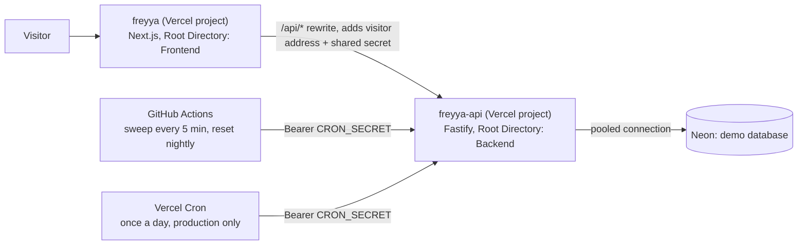

# Deployment

How the public demo is put together, how to set up your own copy, and what to do when something breaks. Everything here runs on free tiers (Vercel Hobby, Neon Free, GitHub Actions).



Two Vercel projects are built from the one repository. They share nothing but the two secrets listed below.

| Project | Root Directory | Framework | Node | Region |
| --- | --- | --- | --- | --- |
| `freyya` | `Frontend` | Next.js | 22.x | default |
| `freyya-api` | `Backend` | Fastify | 22.x | `fra1` (set in `Backend/vercel.json`, next to the Neon database in `aws-eu-central-1`) |

## What makes the API safe to run serverless

A serverless instance can be frozen, duplicated or thrown away between two requests. Each of these was a problem in the original design and has a test in `Backend/tests/serverless.test.ts`:

| Concern | How it is handled |
| --- | --- |
| Expired stock holds, with no timer to rely on | Released when an order is placed, when the catalog is read, and by `/internal/sweep-reservations` on a schedule. Releasing is exactly-once: the update only applies while the order is still `pending_payment` |
| Clocks differing between instances | Every time comparison and timestamp uses the database clock (`now()`), never the process clock. A test fakes the process clock and shows nothing changes |
| In-memory rate limits (each instance would count separately) | Counters live in Postgres (`rate_limits`) and are updated with one atomic `INSERT ... ON CONFLICT DO UPDATE`, so every instance shares them |
| The API sees the storefront's address, not the visitor's | The host overwrites `X-Forwarded-For` on every hop. The storefront's `proxy.ts` sends the visitor's address in `X-Freyya-Client-Ip` together with `PROXY_SECRET`, and the API only believes that header when the secret matches |
| Many instances, few connections | A pool of `DB_POOL_MAX` (default 5) per instance, over Neon's pooled (PgBouncer, transaction mode) host. Nothing in a request path relies on session state: only transaction-scoped locks (`pg_advisory_xact_lock`, `SET LOCAL`) are used. Migrations use the direct connection |
| Sessions | Random tokens stored in Postgres, in an `HttpOnly; Secure; SameSite=Lax` cookie. State-changing requests that carry an `Origin` must match `CORS_ORIGINS` exactly |

## Set up your own copy

### 1. The database

1. Create a Neon project. Use a **separate branch** (or project) for the public demo, and never point the tests at it. The tests refuse to run against a database whose host is `DEMO_DATABASE_HOST` or that carries the demo marker.
2. Copy two connection strings: the **pooled** one (host contains `-pooler`) and the **direct** one.
3. Apply the migrations with the direct one, then load the catalog and mark the database as the demo one:

```bash
cd Backend
DATABASE_URL="<direct string>" npm run db:migrate
DATABASE_URL="<direct string>" npm run db:seed
```

```sql
insert into app_meta (key, value) values ('database_role', 'demo')
on conflict (key) do update set value = excluded.value;
```

The marker is what lets `/internal/demo-reset` run. Without it the reset refuses, so a production database can never be wiped by it.

### 2. Generate the secrets

Never paste these into chat or commit them. Generate them and pipe them straight into the tool that stores them.

```bash
openssl rand -hex 32     # CRON_SECRET
openssl rand -hex 32     # PROXY_SECRET
npm --prefix Backend run admin:hash -- "the demo admin password"   # ADMIN_PASSWORD_HASH
```

For the Vercel CLI, `printf '%s' "$VALUE" | vercel env add NAME production --sensitive` reads the value from stdin. For GitHub, `gh secret set NAME < file` does the same.

### 3. The API project (`freyya-api`)

Create a project from the repository with **Root Directory** `Backend`, Framework **Fastify**, Node **22.x**. `Backend/vercel.json` sets the region, a daily cron and the install command; the build is `tsc -p tsconfig.build.json` and runs **no migrations**.

| Variable | Value | Production | Preview |
| --- | --- | --- | --- |
| `DATABASE_URL` | the pooled string | yes | yes |
| `NODE_ENV` | `production` | yes | yes |
| `TRUST_PROXY` | `true` | yes | yes |
| `CORS_ORIGINS` | the storefront's address, for example `https://freyya.vercel.app`. A preview needs its own storefront address here | yes | yes |
| `ADMIN_EMAIL`, `ADMIN_PASSWORD_HASH` | the demo admin | yes | yes |
| `CRON_SECRET` | 16+ characters | yes | yes |
| `PROXY_SECRET` | 16+ characters, the same as the storefront's | yes | yes |
| `DEMO_MODE` | `true` | yes | yes |
| `DEMO_MAX_PENDING_ORDERS`, `RESERVATION_MINUTES`, `LOW_STOCK_THRESHOLD` | optional tuning | optional | optional |

`Backend/vercel.json` also has `ignoreCommand`, so a push that changes nothing in `Backend/` does not rebuild the API.

### 4. The storefront project (`freyya`)

Root Directory `Frontend`, Framework Next.js, Node 22.x. The build needs nothing outside `Frontend/` (checked by building a copy of that folder alone).

| Variable | Value | Production | Preview |
| --- | --- | --- | --- |
| `API_URL` | the API's address, for example `https://freyya-api.vercel.app` | yes | the preview API's address |
| `PROXY_SECRET` | the same as the API's | yes | yes |
| `NEXT_PUBLIC_DEMO_MODE` | `true` | yes | yes |
| `NEXT_PUBLIC_SITE_URL` | the storefront's address | optional | optional |
| `API_BYPASS_TOKEN` | the API project's deployment-protection bypass token | never | previews only |

`API_URL` is baked into the `/api/*` rewrite when the app builds. Changing it needs a new deployment.

Preview deployments are behind Vercel's deployment protection. A storefront preview can only reach an API preview if it sends the API project's bypass token, which is what `API_BYPASS_TOKEN` is for. The `Frontend/proxy.ts` and `lib/catalog.ts` forward it as `x-vercel-protection-bypass`. In production, the API is public and the variable is not set.

### 5. GitHub

Repository secrets, used by the workflows in `.github/workflows`:

| Secret | Used by | What it is |
| --- | --- | --- |
| `API_BASE_URL` | sweep, demo reset | the API's production address, with no trailing slash |
| `CRON_SECRET` | sweep, demo reset | the same value as in the API project |
| `DATABASE_URL_UNPOOLED` | migrate | the direct connection to the demo database |

| Workflow | When | What it does |
| --- | --- | --- |
| `sweep.yml` | scheduled every 5 minutes (best effort, see below), or by hand | `POST /internal/sweep-reservations` |
| `demo-reset.yml` | 03:00 UTC daily, or by hand | `POST /internal/demo-reset` |
| `migrate-demo-db.yml` | by hand only | runs `npm run db:migrate` against the direct connection |
| `smoke.yml` | after a successful **production** deployment of the storefront (Vercel names the environment `Production – freyya`, so the workflow matches on the prefix), or by hand | runs `Frontend/e2e-live`, a read-only Playwright project, against the live demo. It needs no secret: it reads the published demo login from `README.md`, waits for `/api/health` to answer, and fails the run with a message if the site does not |
| `ci.yml` | every push and pull request | lint, types, unit and integration tests, build, end-to-end |

GitHub only runs a workflow's schedule from the default branch, and `workflow_dispatch` needs the workflow file to exist there, so the schedules and the manual runs start working once the branch is merged.

## Schedules, and the limits of the free tier

- **Vercel Cron on Hobby runs at most once a day**, at hourly precision, and only for production deployments. `Backend/vercel.json` uses it as a daily backstop (`0 4 * * *`, a `GET` with `Authorization: Bearer $CRON_SECRET`).
- **GitHub Actions does the frequent sweep.** Scheduled workflows are best-effort: GitHub treats `*/5 * * * *` as a request, not a promise. In the first six hours after the merge (24 Oct 2026) it started the sweep twice on its own, at 18:22 and 21:00 UTC. GitHub can also disable scheduled workflows in a repository with no activity for 60 days. The design does not depend on the sweep for correctness. Holds are also released when an order is placed and when the catalog is read, so a late sweep delays nothing a visitor can see.
- **Runtime logs on Hobby are kept for about 30 minutes.** Read them with `vercel logs --project freyya-api` soon after an incident.
- **Functions** run under Fluid compute with the default limits. The pool stays small for that reason.

## Releasing

1. Work on a branch. Both projects build a preview for it. Previews are protected, so open them signed in to Vercel, or use `vercel curl <path> --deployment <url>`, which adds the bypass token for you.
2. Check the preview (see below), then merge the pull request. Merging to `main` deploys both projects to production.
3. If a release adds a migration, run **Migrate the demo database** from the Actions tab *before* merging. Migrations here are additive, so the old code keeps working while it runs.
4. The smoke workflow runs when the production deployment succeeds.

Roll back from the Vercel dashboard (Deployments, then Promote the previous one) or with `vercel rollback`.

## Checking a deployment

```bash
# through the storefront's rewrite
curl -s https://freyya.vercel.app/api/health            # {"status":"ok"}
# the catalog should come from the API
curl -s https://freyya.vercel.app/shop | grep -o 'data-catalog="[a-z]*"'    # live, not snapshot

# the scheduled endpoints refuse a caller without the secret (expect 401)
curl -s -o /dev/null -w '%{http_code}\n' https://freyya-api.vercel.app/internal/sweep-reservations
```

`Frontend/e2e-live` is the same kind of check as a Playwright project: `LIVE_URL=https://freyya.vercel.app npm run test:live`. For a protected preview, also set `LIVE_BYPASS_TOKEN` to the storefront project's bypass token.

## When something breaks

| Symptom | Likely cause |
| --- | --- |
| The API build says `No entrypoint found which imports fastify` | The file named `src/server.ts` must itself `import Fastify from "fastify"` and create the instance. Vercel scans for that |
| Requests to the API hang and then fail with `INTERNAL_FUNCTION_INVOCATION_FAILED`, with no logs | `listen()` was reached only after an `await`. Vercel needs it called while the entrypoint is still loading. `configureApp` is deliberately synchronous |
| The storefront shows `data-catalog="snapshot"` | It could not reach the API: wrong `API_URL`, the API is down, or on a preview the bypass token is missing. Orders are disabled while this is so |
| Admin sign-in says the origin is not allowed (`403 forbidden_origin`) | `CORS_ORIGINS` on the API does not contain the exact origin the browser is on |
| Everyone is rate limited at once | The API is counting the storefront's address. `PROXY_SECRET` differs between the two projects, or is missing from one |
| `/internal/*` answers `401` | `CRON_SECRET` is missing from the API project or differs from the caller's |
| `/internal/demo-reset` answers `403` | `DEMO_MODE` is off, or the database has no demo marker row. This is the guard working |
| Migrations fail through the pooler | Run them with `DATABASE_URL_UNPOOLED` (the **Migrate the demo database** workflow does) |

## Things only the repository owner can do

These cannot be done from the command line or need a decision.

1. Merge the pull request (production deploys on merge).
2. Check the Deployment Protection settings in both Vercel projects: production should be public, previews protected.
3. Confirm the GitHub Actions secrets above exist, and run **Migrate the demo database** once, then **Reset the demo** and **Release expired stock holds** once, to confirm they are green.
4. A pass with a real screen reader. Automated checks cover names, landmarks and focus, but not what a person hears.
5. Rotate the secrets if they were ever exposed. Rotating `CRON_SECRET` or `PROXY_SECRET` means changing it in Vercel (both projects for `PROXY_SECRET`) and GitHub, then redeploying.
